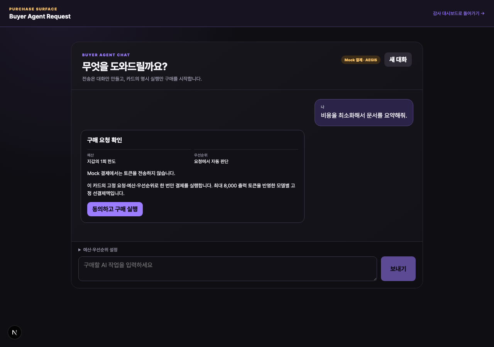

# AEGIS — AI 모델 구매와 감사

AI 구매 에이전트가 요청·예산·Artificial Analysis 기준에 맞춰 모델을 고르고, 그 선택과 결제가 규칙대로였는지 기록하고 감사하는 시스템입니다.

사용자가 채팅으로 요청을 보내고 구매에 동의하면, 구매 에이전트가 OpenAI·Anthropic·Google 모델 후보를 가격·완료시간·성능 세 기준의 고정 가중치로 비교해 하나를 고릅니다. 결제는 x402 방식으로 AEGIS 토큰(Base Sepolia, ERC-3009)을 씁니다. 요청부터 선택·결제·결과·감사까지의 기록은 하나의 구매 ID와 해시 체인으로 묶여 남습니다. 로컬 Qwen 모델은 우선순위 분류와 기록 검토 자문만 맡고, 선택과 결제는 고정 규칙이 결정합니다. 현재는 로컬 데모이며 Provider 응답과 기본 결제 정산은 Mock입니다.

## 기술 스택

| 영역 | 기술 |
|---|---|
| 화면 | Next.js 16, React 19, TypeScript |
| 구매 에이전트·감사 API | Python 3.12, FastAPI, MongoDB |
| 결제 실행·Provider Gateway | TypeScript, viem, x402 v2 (exact + ERC-3009) |
| 스마트 계약 | Solidity 0.8.24, Foundry, Base Sepolia |
| 로컬 LLM | Ollama, Qwen 3.5 4B |
| 모델 비교 데이터 | Artificial Analysis |
